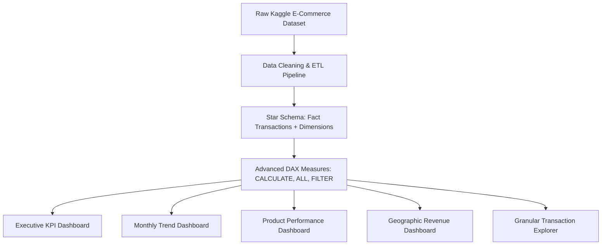

<p align="center">
  
</p>

<p align="center">
     
</p>


## 📌 Table of Contents
- [📖 Executive Summary](#-executive-summary)
- [✨ Key Features & Capabilities](#-key-features--capabilities)
- [🏗️ System Architecture & Workflow](#️-system-architecture--workflow)
- [🛠️ Tech Stack Breakdown](#️-tech-stack-breakdown)
- [⚙️ Reproducible Quickstart & Setup](#️-reproducible-quickstart--setup)
- [📂 Project Directory Layout](#-project-directory-layout)
- [👩‍💻 Author & Contributions](#-author--contributions)

---

## 📖 Executive Summary
### Problem Statement
High-volume international e-commerce enterprises require real-time visibility into sales cycles, customer lifetime value, international order distributions, and SKU performance to optimize pricing and warehouse inventory.

### Motivation & Solution Overview
A complete enterprise data warehouse and interactive Power BI solution analyzing **392,692 cleaned transaction records** from a UK-based e-commerce store (2010–2011), featuring star-schema data modeling, 10 advanced DAX measures, and 5 interactive dashboards.

---

## ✨ Key Features & Capabilities
- **Data Preprocessing & Cleansing:** Removed cancellations, invalid transactions, and negative quantities; engineered calculated columns (`Revenue`, `Order_Year`, `Month_Name`, `Revenue_Tier`, `Is_International`).
- **Star Schema Modeling:** Optimized relationship architecture separating transaction facts from customer, product, and date dimensions.
- **10 Core DAX Measures:** Implemented `SUM`, `AVERAGE`, `COUNT`, `DISTINCTCOUNT`, `IF`, `CALCULATE`, `ALL`, `FILTER`, `MAX`, and `MIN`.
- **5 Executive Dashboards:**
  1. **Executive Overview:** High-level KPIs across revenue, transaction volume, and active customer base.
  2. **Trend Analysis:** Monthly, quarterly, and seasonal sales growth trajectories.
  3. **Product & Category Performance:** Pareto top-selling SKUs and category revenue contributions.
  4. **Geographical Distribution:** Domestic UK vs. International European market breakdowns.
  5. **Transaction Drilldown:** Deep-dive tabular explorer with dynamic multi-filter slicing.

---

## 🏗️ System Architecture & Workflow


---

## 🛠️ Tech Stack Breakdown
| Layer | Tools & Technologies |
|---|---|
| **Business Intelligence Platform** | Microsoft Power BI Desktop (`.pbix`) |
| **Analytical Query Language** | DAX (Data Analysis Expressions) |
| **Data Processing & Prep** | Power Query, Microsoft Excel |
| **Data Model Architecture** | Star Schema Dimensional Modeling |
| **Source Data** | UK Online Retail Dataset (392,692 rows) |

---

## ⚙️ Reproducible Quickstart & Setup
### Prerequisites
- Microsoft Power BI Desktop (Windows)
- Microsoft Excel

### How to Explore
1. Clone the repository:
   ```bash
   git clone https://github.com/Bhumikaravi/Online-Retail-Data-Analysis-.git
   cd Online-Retail-Data-Analysis-
   ```
2. Open `DWM FINAL PROJECT.pbix` in **Microsoft Power BI Desktop**.
3. Explore the 5 interactive dashboard tabs and interact with slicers for date ranges, countries, and product tiers.

---

## 📂 Project Directory Layout
```text
Online-Retail-Data-Analysis-/
├── DWM FINAL PROJECT.pbix             # Full interactive Power BI workbook
├── online_retail_cleaned_dataset.xlsx  # 392,692 cleaned retail transactions
├── Report DWM.pdf                      # Comprehensive academic project report
└── README.md                           # Documentation
```

---

## 👩‍💻 Author & Contributions
Developed by **Bhumika Ravi** ([@Bhumikaravi](https://github.com/Bhumikaravi)), Bachelor of Computer Applications (BCA) at **Alliance University, Bengaluru**.

- 💻 **GitHub Profile:** [github.com/Bhumikaravi](https://github.com/Bhumikaravi)
- 🔗 **LinkedIn:** [linkedin.com/in/bhumika-ravi-b5a01b326](https://www.linkedin.com/in/bhumika-ravi-b5a01b326/)
- 📬 **Email Contact:** [bhumikaravi2006@gmail.com](mailto:bhumikaravi2006@gmail.com)

---

<p align="center">
  
</p>
